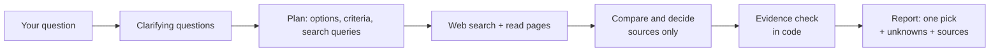

# Research Decision Agent

**Stop researching. Get one clear answer.**

An AI agent that researches a decision for you: it finds the real options,
compares only the factors that actually separate them, throws away the noise,
and gives you **one recommendation**. When something can't be verified, it tells
you so instead of guessing.

```
> What are you deciding? Best laptop under 70k for Python and light ML

  > planning...
  > searching: ...
  > 27 sources collected
  > comparing and deciding...

## Pick: <one option>
Confidence: medium
This would change if: <the one fact that would flip the answer>
## What I couldn't verify
...
```

---

## Why

Most decisions get stuck in the research phase: twenty tabs, conflicting blog
posts, spec sheets full of numbers that don't matter. This agent does that
research and hands back a short, sourced verdict that you can check in a minute.

## Features

- **Asks before it searches.** Up to 3 questions, and only ones whose answers change the pick (budget, must-haves, how you'll use it).
- **Researches live.** It searches the web and reads the top pages for each option.
- **Removes noise.** It keeps only criteria where the options differ *and* that affect the outcome. Everything it dropped is listed as noise.
- **Gives one recommendation.** You get a pick, a confidence level, a runner-up, and the single fact that would change the answer.
- **Doesn't guess, and the code enforces it** ([details below](#how-it-avoids-guessing)).
- **Saves every report** as Markdown in the `decisions/` folder.

## How it works



## How it avoids guessing

Telling an AI "don't make things up" isn't enough on its own, so the code checks its output:

| Situation | What happens |
|---|---|
| A fact has no source | Marked **unknown**, and the claimed value is shown but not trusted |
| A fact cites a source that was never fetched | Marked **unverified** |
| Two sources disagree | Marked **conflicting**, with both values shown |
| The recommendation relies on an unverified fact | Confidence is **automatically lowered** |

The "What I couldn't verify" section is printed **above** the comparison table, so it can't be skimmed past.

## Two versions

| | `decide_free.py` (recommended) | `decide.py` |
|---|---|---|
| AI model | Google Gemini (free tier) | Anthropic Claude |
| Web search | DuckDuckGo (`ddgs`, no key) | Claude's built-in web search |
| Cost | Free | Paid API (a few rupees per run) |
| Key | [Google AI Studio](https://aistudio.google.com/apikey) | [Claude Platform](https://platform.claude.com) |

---

## Quick start (Windows, one click)

1. Install [Python 3.9+](https://www.python.org/downloads/) and tick **"Add Python to PATH"** during setup.
2. Download or clone this repo.
3. Get a free Gemini API key at https://aistudio.google.com/apikey.
4. Double-click **`Research.bat`**.
   - The first run sets everything up and asks for your key once (it's saved locally in `gemini_key.txt`, which is git-ignored).
   - After that, double-click, type your question, and read the answer.

## Manual setup (any OS)

```bash
git clone https://github.com/shekharrx/research-decision-agent.git
cd research-decision-agent

python -m venv .venv
# Windows:   .venv\Scripts\activate
# Mac/Linux: source .venv/bin/activate

pip install -r requirements_free.txt
```

Set your key (or let the script ask you and save it):

```bash
# Windows PowerShell
$env:GEMINI_API_KEY="your-key"
# Mac/Linux
export GEMINI_API_KEY="your-key"
```

Run:

```bash
python decide_free.py "Best discount broker for intraday F&O in India"
```

### Options

| Flag | Default | What it does |
|---|---|---|
| `--no-questions` | off | Skip the clarifying questions |
| `--queries N` | 8 | Number of web searches |
| `--per-query N` | 4 | Results read per search |
| `--region` | `in-en` | Search region (`wt-wt` = global) |
| `--fast` | off | Use search snippets only and don't open pages (faster, less accurate) |
| `--model` | `gemini-3.8-flash` | Gemini model to use |
| `--out` | `decisions` | Folder for saved reports |

### Using the Claude version

```bash
pip install -r requirements.txt
export ANTHROPIC_API_KEY="sk-ant-..."
python decide.py "your question"
```

## Project structure

```
research-decision-agent/
├── decide_free.py          # Free agent: Gemini + DuckDuckGo
├── decide.py               # Claude agent: Claude + built-in web search
├── Research.bat            # Windows one-click launcher (sets up venv on first run)
├── requirements_free.txt   # Dependencies for the free version
├── requirements.txt        # Dependencies for the Claude version
├── LICENSE
└── README.md
```

## Limitations

- The free version reads only the first ~3,500 characters of each page, so facts that are deep in a long page can be missed and will show up as *unknown*.
- DuckDuckGo search and the Gemini free tier both have rate limits. The script waits and retries automatically.
- Prices and fees change often. Always check the linked source before acting on a recommendation, especially for financial decisions.

## Tech stack

Python · Google Gemini API · Anthropic Claude API · DuckDuckGo search (`ddgs`) · Requests

## Author

**Himanshu Shekhar** · [GitHub @shekharrx](https://github.com/shekharrx)

## License

[MIT](LICENSE)
